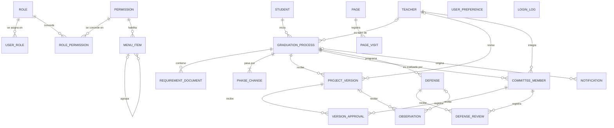

# Entity Model

Modelo de entidades del sistema de seguimiento de trámites de titulación, derivado de
[requirements.md](requirements.md). Los nombres siguen el [glosario](glossary.md).

USERS (id, name, email, password, email_verified_at, two_factor_secret) ships with the Laravel starter project and is an external boundary. It gains the attributes `is_active` (Boolean, Not Null): false when the account is deactivated and true while it can log in, and `must_change_password` (Boolean, Not Null): true while the user still has the initial password that UC-001 BR-005 sets, false once the user changes it.

## Entity Relationship Diagram

USER_PREFERENCE y LOGIN_LOG solo se relacionan con USERS, por eso aparecen sin líneas.

### ROLE

Conjunto de permisos que se asigna a los usuarios, como estudiante, docente o director de carrera.

| Attribute   | Description                                                    | Data Type | Length/Precision | Validation Rules      |
|-------------|----------------------------------------------------------------|-----------|------------------|-----------------------|
| id          | Identificador único                                            | Long      | 19               | Primary Key, Sequence |
| name        | Nombre del rol que ven los usuarios                            | String    | 50               | Not Null, Unique      |
| description | Para qué sirve el rol                                          | String    | 255              | Optional              |
| is_system   | Verdadero para el rol de administrador del sistema, que no se puede borrar | Boolean   | 1                | Not Null              |

### PERMISSION

Autorización para ejecutar una acción o ver una página del sistema.

| Attribute   | Description                                              | Data Type | Length/Precision | Validation Rules |
|-------------|----------------------------------------------------------|-----------|------------------|------------------|
| id          | Identificador único                                      | Long      | 19               | Primary Key, Sequence |
| key         | Clave con la que el sistema comprueba el permiso (`tramites.ver`) | String    | 100              | Not Null, Unique |
| name        | Nombre del permiso que ve el administrador del sistema   | String    | 100              | Not Null         |
| description | Qué permite el permiso                                   | String    | 255              | Optional         |

### ROLE_PERMISSION

Permiso concedido a un rol.

| Attribute  | Description          | Data Type | Length/Precision | Validation Rules                      |
|------------|----------------------|-----------|------------------|---------------------------------------|
| role_id    | Rol que recibe el permiso | Long      | 19               | Primary Key, Foreign Key (ROLE.id)     |
| permission_id | Permiso concedido    | Long      | 19               | Primary Key, Foreign Key (PERMISSION.id) |

### USER_ROLE

Rol asignado a un usuario; un usuario puede tener varios y trabaja con uno activo a la vez.

| Attribute | Description                                  | Data Type | Length/Precision | Validation Rules                    |
|-----------|----------------------------------------------|-----------|------------------|-------------------------------------|
| user_id   | Usuario que recibe el rol                    | Long      | 19               | Primary Key, Foreign Key (USERS.id) |
| role_id   | Rol asignado                                 | Long      | 19               | Primary Key, Foreign Key (ROLE.id)   |
| is_active | Verdadero para el rol con el que trabaja el usuario | Boolean   | 1                | Not Null                            |

#### Constraints

- Cada usuario con al menos un rol tiene exactamente un rol con `is_active` verdadero.

### MENU_ITEM

Opción de la barra de navegación, visible para los roles que tienen su permiso.

| Attribute  | Description                                         | Data Type | Length/Precision | Validation Rules                      |
|------------|-----------------------------------------------------|-----------|------------------|---------------------------------------|
| id         | Identificador único                                 | Long      | 19               | Primary Key, Sequence                 |
| title      | Texto de la opción en el menú                       | String    | 50               | Not Null                              |
| route_name | Nombre de la ruta a la que lleva la opción          | String    | 100              | Optional                              |
| icon       | Nombre del icono de la opción                       | String    | 50               | Optional                              |
| sort_order | Posición de la opción dentro de su grupo            | Integer   | 10               | Not Null, Min: 1, Max: 999            |
| parent_id  | Opción que agrupa a esta en un submenú              | Long      | 19               | Optional, Foreign Key (MENU_ITEM.id) |
| permission_id | Permiso que habilita la opción                      | Long      | 19               | Not Null, Foreign Key (PERMISSION.id)    |

#### Constraints

- Una opción sin `route_name` agrupa a otras: al menos una opción la tiene como `parent_id`.

### USER_PREFERENCE

Preferencias de presentación y accesibilidad de un usuario.

| Attribute      | Description                                                    | Data Type | Length/Precision | Validation Rules                            |
|----------------|----------------------------------------------------------------|-----------|------------------|---------------------------------------------|
| user_id        | Usuario dueño de las preferencias                              | Long      | 19               | Primary Key, Foreign Key (USERS.id)         |
| theme          | Tema elegido                                                   | String    | 20               | Not Null, Values: Niños, Jóvenes, Adultos   |
| color_mode     | Modo día o noche; `Sistema` sigue el modo del sistema operativo | String    | 20               | Not Null, Values: Sistema, Día, Noche       |
| font_size_percent | Tamaño de la fuente en porcentaje del tamaño normal            | Integer   | 10               | Not Null, Min: 75, Max: 200                 |
| high_contrast  | Verdadero cuando el modo de alto contraste está activo         | Boolean   | 1                | Not Null                                    |

### STUDENT

Persona inscrita en la carrera que elabora un proyecto de grado para titularse.

| Attribute            | Description                                                                 | Data Type | Length/Precision | Validation Rules                         |
|----------------------|-----------------------------------------------------------------------------|-----------|------------------|------------------------------------------|
| id                   | Identificador único                                                         | Long      | 19               | Primary Key, Sequence                    |
| user_id              | Cuenta del estudiante                                                       | Long      | 19               | Not Null, Unique, Foreign Key (USERS.id) |
| registration_number  | Número de registro universitario                                            | String    | 20               | Not Null, Unique                         |
| id_card_number       | Número de la cédula de identidad                                            | String    | 20               | Not Null                                 |
| id_card_complement   | Complemento que el SEGIP asigna cuando dos ciudadanos tienen el mismo número | String    | 5                | Optional                                 |
| phone                | Teléfono de contacto                                                        | String    | 20               | Optional, Format: Phone                  |

#### Constraints

- La cédula de identidad es única: id_card_number e id_card_complement son únicos juntos, y un estudiante sin complemento no comparte su número con otro estudiante sin complemento.

### TEACHER

Profesional que enseña en la carrera y puede ser tutor, revisor o miembro del tribunal.

| Attribute                  | Description                                         | Data Type | Length/Precision | Validation Rules                         |
|----------------------------|-----------------------------------------------------|-----------|------------------|------------------------------------------|
| id                         | Identificador único                                 | Long      | 19               | Primary Key, Sequence                    |
| user_id                    | Cuenta del docente                                  | Long      | 19               | Not Null, Unique, Foreign Key (USERS.id) |
| is_workshop_teacher        | Verdadero para el docente designado de taller de grado | Boolean   | 1                | Not Null                                 |
| is_active                  | Falso cuando el docente ya no participa en nuevos trámites | Boolean   | 1                | Not Null                                 |

#### Constraints

- A lo sumo un docente tiene `is_workshop_teacher` verdadero.
- Un docente con `is_workshop_teacher` verdadero está activo.

### GRADUATION_PROCESS

Proceso de un estudiante para titularse por Proyecto de Grado, desde su registro hasta el archivo.

| Attribute         | Description                                              | Data Type | Length/Precision | Validation Rules                                                                     |
|-------------------|----------------------------------------------------------|-----------|------------------|--------------------------------------------------------------------------------------|
| id                | Identificador único                                      | Long      | 19               | Primary Key, Sequence                                                                |
| student_id        | Estudiante que realiza el trámite                        | Long      | 19               | Not Null, Foreign Key (STUDENT.id)                                                |
| tutor_id          | Docente que guía el proyecto de grado                    | Long      | 19               | Optional, Foreign Key (TEACHER.id)                                                   |
| proposed_tutor_name | Nombre del tutor que el estudiante propone en su carta de solicitud | String    | 150              | Optional                                                                             |
| project_title     | Título del proyecto de grado, tomado de la versión aprobada de la fase Evaluación de perfil | String    | 300              | Optional                                                                             |
| phase             | Fase actual del trámite                                  | String    | 30               | Not Null, Values: Requisitos, Evaluación de perfil, Pre-defensa, Defensa formal, Archivo |
| started_at        | Fecha y hora del registro del trámite                    | DateTime  | -                | Not Null                                                                             |
| concluded_at      | Fecha y hora en que se registró la calificación          | DateTime  | -                | Optional                                                                             |
| abandoned_at      | Fecha y hora en que un miembro del tribunal registró la inasistencia del estudiante | DateTime  | -                | Optional                                                                             |
| archived_at       | Fecha y hora en que el asistente administrativo lo archivó | DateTime  | -                | Optional                                                                             |

#### Constraints

- Un estudiante tiene a lo sumo un trámite de titulación sin `concluded_at` ni `abandoned_at`, y a lo sumo un trámite aprobado.
- Un trámite no tiene a la vez `concluded_at` y `abandoned_at`; `abandoned_at` es posterior a `started_at`.
- Un trámite tiene `abandoned_at` si y solo si una de sus pre-defensas o defensas formales tiene `is_student_absent` verdadero.
- `concluded_at` es posterior a `started_at`. Solo un trámite concluido o abandonado tiene `archived_at`, posterior a su `concluded_at` o `abandoned_at`.
- Un trámite en fase `Archivo` tiene `archived_at`; un trámite con `archived_at` está en fase `Archivo`.
- Desde la fase `Evaluación de perfil` en adelante, el trámite tiene `tutor_id`.

### PHASE_CHANGE

Entrada de un trámite de titulación en una fase, con la fecha y hora en que entró.

| Attribute             | Description                                      | Data Type | Length/Precision | Validation Rules                                                                     |
|-----------------------|--------------------------------------------------|-----------|------------------|--------------------------------------------------------------------------------------|
| id                    | Identificador único                              | Long      | 19               | Primary Key, Sequence                                                                |
| graduation_process_id | Trámite que cambió de fase                       | Long      | 19               | Not Null, Foreign Key (GRADUATION_PROCESS.id)                                        |
| phase                 | Fase en la que entró el trámite                  | String    | 30               | Not Null, Values: Requisitos, Evaluación de perfil, Pre-defensa, Defensa formal, Archivo |
| entered_at            | Fecha y hora en que el trámite entró en la fase  | DateTime  | -                | Not Null                                                                             |
| changed_by            | Usuario cuya acción hizo entrar al trámite en la fase | Long      | 19               | Not Null, Foreign Key (USERS.id)                                                     |

#### Constraints

- Un trámite entra en cada fase a lo sumo una vez (graduation_process_id, phase son únicos juntos).
- La primera entrada de un trámite tiene `entered_at` igual a su `started_at`, y es la fase `Requisitos` o `Evaluación de perfil`.
- Las fases de un trámite se suceden en el orden Requisitos, Evaluación de perfil, Pre-defensa, Defensa formal, Archivo, sin volver atrás; un trámite abandonado puede pasar a `Archivo` desde la fase en que quedó.
- La entrada más reciente de un trámite tiene la misma fase que `GRADUATION_PROCESS.phase`.

### REQUIREMENT_DOCUMENT

Documento de requisitos del estudiante adjuntado al trámite; las versiones anteriores se conservan.

| Attribute      | Description                                           | Data Type | Length/Precision | Validation Rules                                                          |
|----------------|-------------------------------------------------------|-----------|------------------|---------------------------------------------------------------------------|
| id             | Identificador único                                   | Long      | 19               | Primary Key, Sequence                                                     |
| graduation_process_id | Trámite al que pertenece                              | Long      | 19               | Not Null, Foreign Key (GRADUATION_PROCESS.id)                             |
| type           | Clase de documento                                    | String    | 30               | Not Null, Values: Boleta de inscripción, Hoja de vida, Carta de solicitud |
| file_path      | Ruta del PDF en el almacenamiento de archivos del servidor | String    | 500              | Not Null, Unique                                                          |
| original_file_name | Nombre original del archivo                           | String    | 255              | Not Null                                                                  |
| file_size_bytes | Tamaño del archivo en bytes                           | Integer   | 10               | Not Null, Min: 1, Max: 20971520                                           |
| uploaded_by    | Usuario que adjuntó el documento                      | Long      | 19               | Not Null, Foreign Key (USERS.id)                                          |
| uploaded_at    | Fecha y hora en que se adjuntó                        | DateTime  | -                | Not Null                                                                  |

### PROJECT_VERSION

Archivo del proyecto de grado que el estudiante sube en una fase; el perfil de proyecto es la versión de la fase
Evaluación de perfil.

| Attribute      | Description                                                 | Data Type | Length/Precision | Validation Rules                                                                  |
|----------------|-------------------------------------------------------------|-----------|------------------|-----------------------------------------------------------------------------------|
| id             | Identificador único                                         | Long      | 19               | Primary Key, Sequence                                                             |
| graduation_process_id | Trámite al que pertenece                                    | Long      | 19               | Not Null, Foreign Key (GRADUATION_PROCESS.id)                                     |
| number         | Número de la versión dentro del trámite                     | Integer   | 10               | Not Null, Min: 1, Max: 999                                                        |
| phase          | Fase del trámite a la que corresponde la versión            | String    | 30               | Not Null, Values: Evaluación de perfil, Pre-defensa, Defensa formal               |
| title          | Título del proyecto de grado en esta versión                | String    | 300              | Not Null                                                                          |
| file_path      | Ruta del PDF en el almacenamiento de archivos del servidor  | String    | 500              | Not Null, Unique                                                                  |
| original_file_name | Nombre original del archivo                                 | String    | 255              | Not Null                                                                          |
| file_size_bytes | Tamaño del archivo en bytes                                 | Integer   | 10               | Not Null, Min: 1, Max: 20971520                                                   |
| status         | Situación de la revisión                                    | String    | 20               | Not Null, Values: En revisión, Con observaciones, Aprobada, Rechazada, Presentada |
| reviewer_id    | Docente de taller de grado que evalúa el perfil de proyecto | Long      | 19               | Optional, Foreign Key (TEACHER.id)                                                |
| submitted_at   | Fecha y hora de la subida                                   | DateTime  | -                | Not Null                                                                          |
| evaluated_at   | Fecha y hora en que el revisor o el tribunal la resolvió    | DateTime  | -                | Optional                                                                          |

#### Constraints

- El número de versión es único dentro de un trámite (graduation_process_id, number son únicos juntos) y crece de uno en uno, sin reiniciarse al cambiar de fase.
- Una versión de la fase `Evaluación de perfil` tiene `reviewer_id`, salvo que esté `En revisión` mientras no hay un docente de taller de grado designado; una de otra fase no lo tiene.
- Una versión `Aprobada` o `Rechazada` de la fase `Evaluación de perfil` tiene `reviewer_id`.
- `Rechazada` solo se da en la fase `Evaluación de perfil`; `Presentada` solo en la fase `Defensa formal`, cuyas versiones no se revisan antes de la defensa formal.
- Una versión de la fase `Pre-defensa` está `Aprobada` solo cuando los tres miembros vigentes del tribunal la aprobaron; la aprobación de un miembro reemplazado no cuenta.
- Una versión `Aprobada`, `Rechazada` o `Con observaciones` tiene `evaluated_at`, posterior a `submitted_at`.
- Un trámite tiene a lo sumo una versión `En revisión` y a lo sumo una versión `Aprobada` por fase.
- Una versión `Rechazada` tiene al menos una observación de su revisor; una versión `Con observaciones` tiene al menos una observación de un miembro del tribunal vigente que no la aprobó. Las observaciones del tutor, y las de un miembro que aprobó la versión, no cambian su estado.
- Una versión de la fase `Pre-defensa` deja de estar `En revisión` solo cuando cada uno de los tres miembros vigentes del tribunal se pronunció: la aprobó (VERSION_APPROVAL) o registró observaciones sin aprobarla.
- Una versión de la fase `Pre-defensa` o `Defensa formal` tiene como `title` el `project_title` de su trámite, que no cambia una vez fijado.

### COMMITTEE_MEMBER

Docente asignado al tribunal evaluador de un trámite de titulación.

| Attribute   | Description                          | Data Type | Length/Precision | Validation Rules                                 |
|-------------|--------------------------------------|-----------|------------------|--------------------------------------------------|
| id          | Identificador único                  | Long      | 19               | Primary Key, Sequence                            |
| graduation_process_id | Trámite que evalúa                   | Long      | 19               | Not Null, Foreign Key (GRADUATION_PROCESS.id)    |
| teacher_id  | Docente miembro del tribunal         | Long      | 19               | Not Null, Foreign Key (TEACHER.id)               |
| assigned_at | Fecha y hora de la asignación        | DateTime  | -                | Not Null                                         |
| replaced_at | Fecha y hora en que el director de carrera lo reemplazó | DateTime  | -                | Optional                                         |

#### Constraints

- Un trámite tiene exactamente tres miembros del tribunal vigentes, sin `replaced_at`, una vez asignado el tribunal evaluador (C-006).
- Un docente es miembro del tribunal de un trámite a lo sumo una vez (graduation_process_id, teacher_id son únicos juntos); un miembro reemplazado no vuelve al mismo tribunal.
- `replaced_at` es posterior a `assigned_at`.
- El tutor del trámite no es miembro de su tribunal evaluador.

### VERSION_APPROVAL

Aprobación que un miembro del tribunal registra sobre una versión de la fase Pre-defensa.

| Attribute           | Description                      | Data Type | Length/Precision | Validation Rules                               |
|---------------------|----------------------------------|-----------|------------------|------------------------------------------------|
| project_version_id  | Versión aprobada                 | Long      | 19               | Primary Key, Foreign Key (PROJECT_VERSION.id) |
| committee_member_id | Miembro del tribunal que aprueba | Long      | 19               | Primary Key, Foreign Key (COMMITTEE_MEMBER.id) |
| approved_at         | Fecha y hora de la aprobación    | DateTime  | -                | Not Null                                       |

#### Constraints

- La versión es de la fase `Pre-defensa`.
- El miembro del tribunal pertenece al tribunal del trámite de la versión.

### DEFENSE

Pre-defensa o defensa formal programada de un proyecto de grado.

| Attribute    | Description                                       | Data Type | Length/Precision | Validation Rules                                 |
|--------------|---------------------------------------------------|-----------|------------------|--------------------------------------------------|
| id           | Identificador único                               | Long      | 19               | Primary Key, Sequence                            |
| graduation_process_id | Trámite al que pertenece                          | Long      | 19               | Not Null, Foreign Key (GRADUATION_PROCESS.id)    |
| type         | Pre-defensa o defensa formal                      | String    | 20               | Not Null, Values: Pre-defensa, Defensa formal    |
| scheduled_at | Fecha y hora programadas                          | DateTime  | -                | Not Null                                         |
| location     | Ambiente donde se realiza                         | String    | 100              | Optional                                         |
| grade        | Calificación conjunta del tribunal evaluador      | Integer   | 10               | Optional, Min: 0, Max: 100                       |
| is_held      | Verdadero cuando la pre-defensa o defensa formal ya se realizó | Boolean   | 1                | Not Null                                         |
| is_student_absent | Verdadero cuando el tribunal registró que el estudiante no se presentó | Boolean   | 1                | Not Null                                         |

#### Constraints

- Solo una `Defensa formal` realizada con el estudiante presente tiene `grade`, y toda la tiene (C-007).
- Solo una pre-defensa o defensa formal realizada tiene `is_student_absent` verdadero.
- Un trámite tiene a lo sumo una `Pre-defensa` y una `Defensa formal` sin realizar.
- La `Defensa formal` de un trámite es posterior a una `Pre-defensa` realizada del mismo trámite.

### DEFENSE_REVIEW

Registro que un miembro del tribunal hace de una pre-defensa o defensa formal: sus observaciones de la pre-defensa, o
su calificación de la defensa formal.

| Attribute           | Description                                    | Data Type | Length/Precision | Validation Rules                                |
|---------------------|------------------------------------------------|-----------|------------------|-------------------------------------------------|
| defense_id          | Pre-defensa o defensa formal registrada        | Long      | 19               | Primary Key, Foreign Key (DEFENSE.id)           |
| committee_member_id | Miembro del tribunal que la registra           | Long      | 19               | Primary Key, Foreign Key (COMMITTEE_MEMBER.id)  |
| has_observations    | Verdadero cuando el miembro registró observaciones de la pre-defensa | Boolean   | 1                | Not Null                                        |
| grade               | Calificación que el miembro da a la defensa formal | Integer   | 10               | Optional, Min: 0, Max: 100                      |
| recorded_at         | Fecha y hora del registro                      | DateTime  | -                | Not Null                                        |

#### Constraints

- `recorded_at` es posterior al `scheduled_at` de la defensa.
- El miembro del tribunal pertenece al tribunal del trámite de la defensa y está vigente al registrar.
- En una `Pre-defensa`, el registro no tiene `grade`; con `has_observations` verdadero tiene al menos una observación del miembro sobre esa pre-defensa, y con falso ninguna.
- En una `Defensa formal`, el registro tiene `grade` y `has_observations` es falso.
- Una pre-defensa o defensa formal con el estudiante presente está realizada (`is_held`) cuando sus tres miembros vigentes del tribunal la registraron.
- El `grade` de una `Defensa formal` realizada es el promedio de las calificaciones de sus tres registros, redondeado al entero, con las mitades hacia arriba.

### OBSERVATION

Señalamiento sobre una versión del proyecto o sobre una pre-defensa.

| Attribute          | Description                                  | Data Type | Length/Precision | Validation Rules                           |
|--------------------|----------------------------------------------|-----------|------------------|--------------------------------------------|
| id                 | Identificador único                          | Long      | 19               | Primary Key, Sequence                      |
| author_id          | Revisor, tutor o miembro del tribunal que la registra | Long      | 19               | Not Null, Foreign Key (USERS.id)           |
| project_version_id | Versión del proyecto observada               | Long      | 19               | Optional, Foreign Key (PROJECT_VERSION.id) |
| defense_id         | Pre-defensa observada                        | Long      | 19               | Optional, Foreign Key (DEFENSE.id)         |
| body               | Contenido de la observación                  | String    | 2000             | Not Null                                   |
| recorded_at        | Fecha y hora del registro                    | DateTime  | -                | Not Null                                   |

#### Constraints

- Exactamente uno de `project_version_id` y `defense_id` tiene valor.
- Una observación con `defense_id` se refiere a una `Pre-defensa`.

### NOTIFICATION

Mensaje que el sistema muestra a un usuario cuando cambia un trámite de titulación en el que participa.

| Attribute  | Description                                  | Data Type | Length/Precision | Validation Rules                              |
|------------|----------------------------------------------|-----------|------------------|-----------------------------------------------|
| id         | Identificador único                          | Long      | 19               | Primary Key, Sequence                         |
| user_id    | Destinatario                                 | Long      | 19               | Not Null, Foreign Key (USERS.id)              |
| graduation_process_id | Trámite que originó la notificación          | Long      | 19               | Optional, Foreign Key (GRADUATION_PROCESS.id) |
| message    | Texto de la notificación                     | String    | 500              | Not Null                                      |
| created_at | Fecha y hora de creación                     | DateTime  | -                | Not Null                                      |
| read_at    | Fecha y hora en que el destinatario la leyó  | DateTime  | -                | Optional                                      |

### LOGIN_LOG

Entrada de la bitácora por cada intento de inicio de sesión, exitoso o fallido.

| Attribute       | Description                                       | Data Type | Length/Precision | Validation Rules                  |
|-----------------|---------------------------------------------------|-----------|------------------|-----------------------------------|
| id              | Identificador único                               | Long      | 19               | Primary Key, Sequence             |
| user_id         | Usuario al que corresponde el correo, si existe   | Long      | 19               | Optional, Foreign Key (USERS.id)  |
| attempted_email  | Correo con el que se intentó iniciar sesión      | String    | 255              | Not Null                          |
| is_successful   | Verdadero si el inicio de sesión fue exitoso      | Boolean   | 1                | Not Null                          |
| ip_address      | Dirección IP de origen, IPv4 o IPv6               | String    | 45               | Not Null                          |
| user_agent      | Navegador y sistema operativo del cliente         | String    | 500              | Optional                          |
| occurred_at     | Fecha y hora del intento                          | DateTime  | -                | Not Null                          |

### PAGE

Página del sistema con su contador de visitas, que se muestra en su pie de página.

| Attribute   | Description                     | Data Type | Length/Precision | Validation Rules                  |
|-------------|---------------------------------|-----------|------------------|-----------------------------------|
| id          | Identificador único             | Long      | 19               | Primary Key, Sequence             |
| route_name  | Nombre de la ruta de la página  | String    | 100              | Not Null, Unique                  |
| visit_count | Número de visitas registradas   | Integer   | 10               | Not Null, Min: 0, Max: 2147483647 |

#### Constraints

- `visit_count` es igual al número de filas de PAGE_VISIT de la página.

### PAGE_VISIT

Entrada de la bitácora por cada visita a una página.

| Attribute  | Description                          | Data Type | Length/Precision | Validation Rules                 |
|------------|--------------------------------------|-----------|------------------|----------------------------------|
| id         | Identificador único                  | Long      | 19               | Primary Key, Sequence            |
| page_id    | Página visitada                      | Long      | 19               | Not Null, Foreign Key (PAGE.id)  |
| user_id    | Usuario que visitó la página         | Long      | 19               | Optional, Foreign Key (USERS.id) |
| ip_address | Dirección IP de origen, IPv4 o IPv6  | String    | 45               | Not Null                         |
| visited_at | Fecha y hora de la visita            | DateTime  | -                | Not Null                         |
